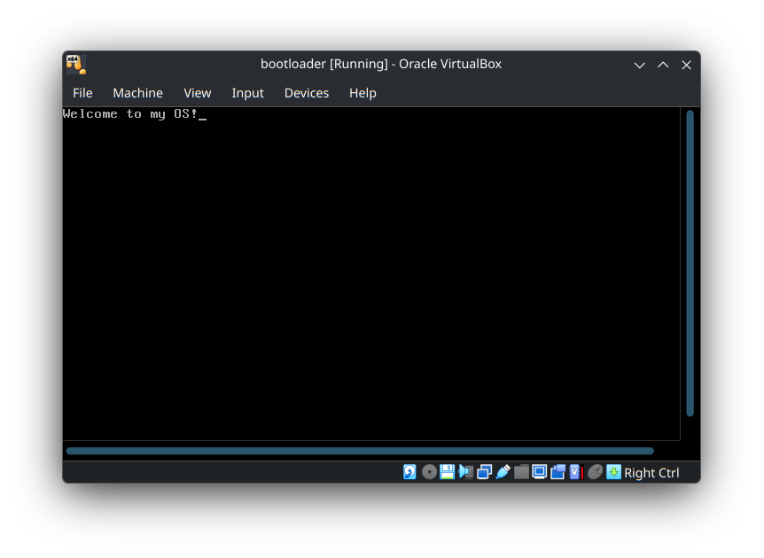

# Bootloader written in x86-64 Assembly

This project showcases a bootloader written in x86-64 assembly. It boots, displays text, and uses BIOS-level system calls to manage bare-metal CPU registers.

## Project Files
- `bootloader.asm`: The assembly code
- `bootloader.bin`: The binary the .asm file compiles down to
- `bootloader.flp`: A floppydisk format of the binary for easy booting

## Finished Result

